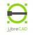
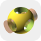
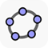
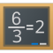
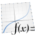
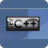

# Прикладное программное обеспечение

>Библиотека приложений содержит необходимые программы и утилиты для осуществления деятельности образовательной организацией в среде ОС Astra Linux SE 1.8.
>Приложения распространяются в виде установочных deb-пакетов

## 📁 Офис

| | Название и версия | Описание | Официальный сайт | Ссылка на скачивание |
| --- | --- | --- | --- | --- |
|  | **Boomaga** (3.0.0) | Программа предоставляет виртуальный принтер для CUPS, так же ее можно использовать для предварительного просмотра или печати PDF буклетов | [boomaga.org](https://www.boomaga.org) | [Скачать пакет](https://github.com/teanrus/astra-gia/releases/tag/v2.0) |
|  | **Foxit PDF Reader** (2.4.5.0727) | Программа для просмотра, редактирования, аннотирования и работы с PDF-файлами | [foxit.com](https://www.foxit.com) | [Скачать пакет](https://github.com/teanrus/astra-gia/releases/tag/v2.0) |
|  | **GenOffice** (0.9.431) | Открытый офисный пакет, главная фишка которого в том, что искусственный интеллект встроен прямо в рабочие процессы | [github.com/genspark-ai/genoffice](https://github.com/genspark-ai/genoffice) | [Скачать пакет](https://github.com/teanrus/astra-gia/releases/tag/v2.0) |
|  | **NAPS2** (7.5.3) | Бесплатная и свободная утилита для сканирования документов и сохранения в PDF, TIFF, JPEG или PNG в один клик | [naps2.com](https://naps2.com) | [Скачать пакет](https://github.com/teanrus/astra-gia/releases/tag/v2.0) |
|  | **OnlyOffice Desktop Editors** (9.0.4) | Офисный пакет для работы с документами, электронными таблицами, презентациями, заполняемыми формами и файлами PDF | [onlyoffice.com/ru/download-desktop.aspx](https://onlyoffice.com/ru/download-desktop.aspx) | [Скачать пакет](https://github.com/teanrus/astra-gia/releases/tag/v2.0) |
|  | **OpenOffice** (4.1.16) | Бесплатный и открытый офисный пакет, альтернатива коммерческим решениям вроде Microsoft Office от Apache | [openoffice.org](https://www.openoffice.org) | [Скачать пакет](https://github.com/teanrus/astra-gia/releases/tag/v2.0) |
|  | **PDF Arranger** (1.12.1) | Приложение на языке Python-gtk, которое позволяет объединять или разделять документы в формате PDF, а также поворачивать, обрезать и переставлять их страницы | [github.com/pdfarranger/pdfarranger](https://github.com/pdfarranger/pdfarranger) | [Скачать пакет](https://github.com/teanrus/astra-gia/releases/tag/v2.0) |
|  | **ProjectLibre** (1.9.8) | Бесплатное и открытое программное обеспечение для управления проектами, которое позиционируется как альтернатива коммерческому Microsoft Project | [projectlibre.com](https://projectlibre.com) | [Скачать пакет](https://github.com/teanrus/astra-gia/releases/tag/v2.0) |
|  | **R7 Office** (2026.3.1) | Десктопные редакторы текстовых документов, таблиц и презентаций. Триальная 30-дневная ознакомительная версия | [r7-office.ru](https://r7-office.ru) | [Скачать пакет](https://github.com/teanrus/astra-gia/releases/tag/v2.0) |
|  | **RuPost Desktop** (122.0.188) | Почтовый клиент на базе Thunderbird для замены MS OutLook: быстрый, функциональный, гибкий в настройке | [rupost.ru/desktop/](https://rupost.ru/desktop/) | [Скачать пакет](https://github.com/teanrus/astra-gia/releases/tag/v2.0) |
|  | **WeekToDo** (2.2.0) | Приложение-органайзер для планирования задач на рабочий день. Календарь, списки задач, заметки и прочее | [weektodo.me](https://weektodo.me) | [Скачать пакет](https://github.com/teanrus/astra-gia/releases/tag/v2.0) |
|  | **WPS Office** (11.1.0.11723) | Офисный пакет для работы с документами, таблицами и презентациями | [wps.com](https://www.wps.com) *(на сайте указана ошибка в ссылке)* | [Скачать пакет](https://github.com/teanrus/astra-gia/releases/tag/v2.0) |

---

## 🌐 Интернет

| | Название и версия | Описание | Официальный сайт | Ссылка на скачивание |
| --- | --- | --- | --- | --- |
|  | **Algorius Net Viewer** (2026.6.1) | Комплексный программный продукт для визуализации, администрирования, мониторинга и инвентаризации компьютерной сети любого уровня | [algorius.ru](https://algorius.ru) | [Скачать пакет](https://github.com/teanrus/astra-gia/releases/tag/v2.0) |
|  | **AnyDesk** (8.1.0) | Программное обеспечение для удалённого доступа, управления и обслуживания компьютеров и других конечных устройств | [anydesk.com](https://anydesk.com) | [Скачать пакет](https://github.com/teanrus/astra-gia/releases/tag/v2.0) |
|  | **Chromium ГОСТ** (131.0.6778) | Веб-браузер с поддержкой криптографических алгоритмов ГОСТ (в соответствии с методическими рекомендациями ТК 26) | [cryptopro.ru/products/chromium-gost](https://cryptopro.ru/products/chromium-gost) | [Скачать пакет](https://github.com/teanrus/astra-gia/releases/tag/v2.0) |
|  | **Dion** (5.34.1) | Полноценная ВКС-система от DION с широкими возможностями для комфортного общения | [diongo.ru](https://diongo.ru) | [Скачать пакет](https://github.com/teanrus/astra-gia/releases/tag/v2.0) |
|  | **Epoptes (клиент)** (23.01-1) | Клиентская часть системы удаленного управления компьютерным классом в кабинете информатики | [epoptes.org](https://epoptes.org) | [Скачать пакет](https://github.com/teanrus/astra-gia/releases/tag/v2.0) |
|  | **Epoptes (сервер)** (23.01-1) | Серверная часть системы удаленного управления компьютерным классом в кабинете информатики | [epoptes.org](https://epoptes.org) | [Скачать пакет](https://github.com/teanrus/astra-gia/releases/tag/v2.0) |
|  | **FileZilla** (3.69.5) | Клиент поддерживает FTP, SFTP и FTPS и имеет настраиваемый интерфейс с поддержкой смены тем оформления | [filezilla.ru](https://filezilla.ru) | [Скачать пакет](https://github.com/teanrus/astra-gia/releases/tag/v2.0) |
|  | **FireFox** (151.0.2) | Браузер, разработкой и распространением которого занимается Mozilla Corporation | [mozilla.org](https://mozilla.org) | [Скачать пакет](https://github.com/teanrus/astra-gia/releases/tag/v2.0) |
|  | **Google Chrome** (154.0.8037) | Браузер, разрабатываемый компанией Google на основе свободного браузера Chromium и движка Blink | [google.com/chrome/](https://www.google.com/chrome/) | [Скачать пакет](https://github.com/teanrus/astra-gia/releases/tag/v2.0) |
|  | **LinSSID** (3.6) | Графическая программа для систем Linux, которая позволяет сканировать и находить доступные беспроводные сети Wi-Fi | [sourceforge.net/projects/linssid/](https://sourceforge.net/projects/linssid/) | [Скачать пакет](https://github.com/teanrus/astra-gia/releases/tag/v2.0) |
|  | **Mattermost** (6.2.3) | Клиент системы для обмена мгновенными сообщениями с возможностью обмена файлами, поиска и различных интеграций | [mattermost.com](https://mattermost.com) | [Скачать пакет](https://github.com/teanrus/astra-gia/releases/tag/v2.0) |
|  | **MAX** (1.0) | Российский мессенджер, выпущенный компанией VK. Веб-версия | [max.ru](https://max.ru) | [Скачать пакет](https://github.com/teanrus/astra-gia/releases/tag/v2.0) |
|  | **MuonSSH** (3.0.0) | Графический клиент SSH, предназначенный для упрощения работы с удалёнными серверами | [github.com/devlinx9/muon-ssh](https://github.com/devlinx9/muon-ssh) | [Скачать пакет](https://github.com/teanrus/astra-gia/releases/tag/v2.0) |
|  | **NextCloud Desktop** (33.0.7) | Клиент для синхронизации файлов между вашим компьютером и сервером Nextcloud | [nextcloud.com](https://nextcloud.com) | [Скачать пакет](https://github.com/teanrus/astra-gia/releases/tag/v2.0) |
|  | **QBittorrent** (5.4.0) | Бесплатный кроссплатформенный клиент файлообменной сети BitTorrent с открытым исходным кодом | [qbittorrent.org](https://qbittorrent.org) | [Скачать пакет](https://github.com/teanrus/astra-gia/releases/tag/v2.0) |
|  | **Qcad** (3.32.4) | 2-мерная система автоматизированного проектирования (САПР) с открытым исходным кодом | [qcad.ch/en/](https://qcad.ch/en/) | [Скачать пакет](https://github.com/teanrus/astra-gia/releases/tag/v2.0) |
|  | **RuTube** (1.0) | Веб-клиент отечественного видеохостинга в виде десктопного приложения | [rutube.ru](https://rutube.ru) | [Скачать пакет](https://github.com/teanrus/astra-gia/releases/tag/v2.0) |
|  | **Telegram** (6.9.3) | Система мгновенного обмена текстовыми, голосовыми и видеосообщениями | [telegram.org](https://telegram.org) | [Скачать пакет](https://github.com/teanrus/astra-gia/releases/tag/v2.0) |
|  | **Telemost** (1.0) | Российский сервис для организации видеоконференций и онлайн-встреч от Яндекса | [telemost.yandex.ru](https://telemost.yandex.ru) | [Скачать пакет](https://github.com/teanrus/astra-gia/releases/tag/v2.0) |
|  | **Transmission** (4.1.1) | Бесплатный клиент BitTorrent с открытым исходным кодом | [transmissionbt.com](https://transmissionbt.com) | [Скачать пакет](https://github.com/teanrus/astra-gia/releases/tag/v2.0) |
|  | **WinBox 3** (3.43) | Утилита для настройки и управления устройствами MikroTik с RouterOS через графический интерфейс | [mikrotik.wiki/wiki/WinBox](https://mikrotik.wiki/wiki/WinBox) | [Скачать пакет](https://github.com/teanrus/astra-gia/releases/tag/v2.0) |
|  | **WinBox 4** (4.0beta33) | Утилита для настройки и управления устройствами MikroTik с RouterOS через графический интерфейс | [mikrotik.wiki/wiki/WinBox](https://mikrotik.wiki/wiki/WinBox) | [Скачать пакет](https://github.com/teanrus/astra-gia/releases/tag/v2.0) |
|  | **Zoom** (6.4.10) | Проприетарная программа для организации видеоконференций | [zoom.com](https://zoom.com) | [Скачать пакет](https://github.com/teanrus/astra-gia/releases/tag/v2.0) |
|  | **Ассистент** (7.1) | Безопасный удаленный доступ к компьютерам по локальной сети или сети интернет | [мойассистент.рф](https://мойассистент.рф) | [Скачать пакет](https://github.com/teanrus/astra-gia/releases/tag/v2.0) |
|  | **ВК Мессенджер** (6.0.57) | Мессенджер социальной сети «ВКонтакте» с поддержкой образовательной системы «Сферум» | [vk.me/app](https://vk.me/app) | [Скачать пакет](https://github.com/teanrus/astra-gia/releases/tag/v2.0) |
|  | **Контур.Толк** (3.0.0) | Клиент отечественной системы видео-конференц-связи для онлайн-общения и обучения | [kontur.ru/talk](https://kontur.ru/talk) | [Скачать пакет](https://github.com/teanrus/astra-gia/releases/tag/v2.0) |
|  | **Сервис "Среда"** (24.5) | Единая платформа для государственных коммуникаций | [sreda.digital.gov.ru](https://sreda.digital.gov.ru) | [Скачать пакет](https://github.com/teanrus/astra-gia/releases/tag/v2.0) |
|  | **Яндекс Браузер** (26.3.5) | Отечественный веб-браузер, созданный компанией «Яндекс» на основе движка Blink | [browser.yandex.ru](https://browser.yandex.ru) | [Скачать пакет](https://github.com/teanrus/astra-gia/releases/tag/v2.0) |
|  | **Яндекс Диск** (0.1.6.180) | Облачный сервис, принадлежащий компании «Яндекс» | [yandex.ru](https://yandex.ru) | [Скачать пакет](https://github.com/teanrus/astra-gia/releases/tag/v2.0) |
|  | **Яндекс Диск Индикатор** (1.12.2) | Утилита синхронизации командной строки Яндекс.Диск, отображение текущего состояния | [yandex.ru](https://yandex.ru) | [Скачать пакет](https://github.com/teanrus/astra-gia/releases/tag/v2.0) |
|  | **Яндекс Музыка** (5.82.0) | Клиент для музыкального стримингового сервиса от компании Яндекс | [music.yandex.ru/download/](https://music.yandex.ru/download/) | [Скачать пакет](https://github.com/teanrus/astra-gia/releases/tag/v2.0) |

---

## 🎨 Графика

| | Название и версия | Описание | Официальный сайт | Ссылка на скачивание |
| --- | --- | --- | --- | --- |
|  | **Bambu Studio** (1.10.1.50) | Бесплатный 3D-слайсер для печати. Преобразует инструкции печати в G-код | [bambulab.com](https://bambulab.com) | [Скачать пакет](https://github.com/teanrus/astra-gia/releases/tag/v2.0) |
|  | **Blender** (5.2.2) | Профессиональное свободное и открытое ПО для создания трёхмерной компьютерной графики | [blender.org](https://blender.org) | [Скачать пакет](https://github.com/teanrus/astra-gia/releases/tag/v2.0) |
|  | **Draw.io** (26.0.4) | Кроссплатформенное ПО для рисования графиков, разработанное на HTML5 и JavaScript | [drawio.com](https://drawio.com) | [Скачать пакет](https://github.com/teanrus/astra-gia/releases/tag/v2.0) |
|  | **FlameShot** (12.1.0) | Свободная, бесплатная, многофункциональная утилита для создания скриншотов экрана | [flameshot.org](https://flameshot.org) | [Скачать пакет](https://github.com/teanrus/astra-gia/releases/tag/v2.0) |
|  | **Flash Print 3D** (5.8.7) | Слайсер FlashPrint от компании FlashForge для 3D печати | [flashforge.com](https://flashforge.com) | [Скачать пакет](https://github.com/teanrus/astra-gia/releases/tag/v2.0) |
|  | **FreeCAD** (1.1.4) | Параметрическая САПР общего назначения с открытым исходным кодом | [freecad.org](https://freecad.org) | [Скачать пакет](https://github.com/teanrus/astra-gia/releases/tag/v2.0) |
|  | **GIMP 3** (3.0.4) | Свободно распространяемый растровый графический редактор | [gimp.org](https://gimp.org) | [Скачать пакет](https://github.com/teanrus/astra-gia/releases/tag/v2.0) |
|  | **Gromit MPX** (1.7.0) | Свободная утилита для создания заметок и рисования на Рабочем столе | [github.com](https://github.com) | [Скачать пакет](https://github.com/teanrus/astra-gia/releases/tag/v2.0) |
|  | **InkScape** (1.4) | Свободный векторный графический редактор | [inkscape.org](https://inkscape.org) | [Скачать пакет](https://github.com/teanrus/astra-gia/releases/tag/v2.0) |
|  | **Krita** (5.2.6) | Свободный и открытый растровый графический редактор для художников и фотографов | [krita.org](https://krita.org) | [Скачать пакет](https://github.com/teanrus/astra-gia/releases/tag/v2.0) |
|  | **lazpaint** (7.3) | Бесплатный кроссплатформенный редактор изображений с пиксельными и векторными слоями | [lazpaint.github.io](https://lazpaint.github.io) | [Скачать пакет](https://github.com/teanrus/astra-gia/releases/tag/v2.0) |
|  | **Lego Digital Designer** (4.3.11) | Программа для создания виртуальных моделей из деталей Lego | [lego.com](https://lego.com) | [Скачать пакет](https://github.com/teanrus/astra-gia/releases/tag/v2.0) |
|  | **LeoCAD** (23.03) | Компьютерная программа для создания виртуальных моделей с помощью кубиков Lego | [leocad.org](https://leocad.org) | [Скачать пакет](https://github.com/teanrus/astra-gia/releases/tag/v2.0) |
|  | **LibreCAD** (2.2.1.2) | Кроссплатформенная, открытая и свободная САПР для 2-мерного черчения | [librecad.org](https://librecad.org) | [Скачать пакет](https://github.com/teanrus/astra-gia/releases/tag/v2.0) |
|  | **Lorien** (0.6.0) | Кроссплатформенное бесплатное приложение для работы с белыми досками (whiteboard) | [github.com/mbrlabs/Lorien](https://github.com/mbrlabs/Lorien) | [Скачать пакет](https://github.com/teanrus/astra-gia/releases/tag/v2.0) |
|  | **MyPaint** (2.0.1) | Растровый графический редактор, программа для цифровых художников | [mypaint.app](https://mypaint.app) | [Скачать пакет](https://github.com/teanrus/astra-gia/releases/tag/v2.0) |
|  | **OpenBoard** (1.7.6) | Свободное программное обеспечение для интерактивной доски | [openboard.ch](https://openboard.ch) | [Скачать пакет](https://github.com/teanrus/astra-gia/releases/tag/v2.0) |
|  | **OpenSCAD** (2026.03.16) | Открытая САПР для параметрического создания твердотельных трёхмерных объектов | [openscad.org](https://openscad.org) | [Скачать пакет](https://github.com/teanrus/astra-gia/releases/tag/v2.0) |
|  | **OpenToonz** (1.7.1) | Программное обеспечение с открытым исходным кодом для создания двумерной анимации | [opentoonz.github.io](https://opentoonz.github.io) | [Скачать пакет](https://github.com/teanrus/astra-gia/releases/tag/v2.0) |
|  | **Orca Slicer** (2.3.0-dev) | Бесплатный 3D-слайсер для печати | [orca-slicer.com](https://orca-slicer.com) | [Скачать пакет](https://github.com/teanrus/astra-gia/releases/tag/v2.0) |
|  | **Pencil 2D** (0.7.1) | Бесплатная и открытая программа для создания 2D-анимации и рисования | [pencil2d.org/](https://www.pencil2d.org/) | [Скачать пакет](https://github.com/teanrus/astra-gia/releases/tag/v2.0) |
|  | **PhotoFlare** (1.6.14) | Высокопроизводительный и простой C++ / QT универсальный свободный растровый графический редактор | [photoflare.io](https://photoflare.io) | [Скачать пакет](https://github.com/teanrus/astra-gia/releases/tag/v2.0) |
|  | **Pinta** (2.1.2) | Легковесный кроссплатформенный растровый графический редактор с открытым исходным кодом | [pinta-project.com](https://pinta-project.com) | [Скачать пакет](https://github.com/teanrus/astra-gia/releases/tag/v2.0) |
|  | **PolygonX** (2.6.53) | ПО российской разработки для подготовки заданий 3D-печати на принтерах ПИКАСО 3D | [picaso-3d.ru](https://picaso-3d.ru) | [Скачать пакет](https://github.com/teanrus/astra-gia/releases/tag/v2.0) |
|  | **QtQR** (2.1) | Графическое приложение на базе Qt для работы с QR‑кодами | [launchpad.net/qr-tools](https://launchpad.net/qr-tools) | [Скачать пакет](https://github.com/teanrus/astra-gia/releases/tag/v2.0) |
|  | **RawTherapee** (5.12) | Программа для каталогизации и обработки цифровых изображений | [rawtherapee.com](https://rawtherapee.com) | [Скачать пакет](https://github.com/teanrus/astra-gia/releases/tag/v2.0) |
|  | **Rnote** (0.12.0) | Приложение с открытым исходным кодом для создания эскизов и рукописных заметок | [rnote.flxzt.net](https://rnote.flxzt.net) | [Скачать пакет](https://github.com/teanrus/astra-gia/releases/tag/v2.0) |
|  | **SAS.Планета** (250505) | Программа для скачивания и просмотра карт и спутниковых фотографий земной поверхности | [sasgis.org](https://www.sasgis.org) | [Скачать пакет](https://github.com/teanrus/astra-gia/releases/tag/v2.0) |
|  | **Scribus** (1.6.4) | Бесплатное приложение с открытым исходным кодом для издательского дела и вёрстки | [scribus.net](https://scribus.net) | [Скачать пакет](https://github.com/teanrus/astra-gia/releases/tag/v2.0) |
|  | **SweetHome 3D** (7.5) | Приложение для дизайна интерьера с возможностью 3D-просмотра | [sweethome3d.com](https://sweethome3d.com) | [Скачать пакет](https://github.com/teanrus/astra-gia/releases/tag/v2.0) |
|  | **TFlexCad** (17.1.21.0) | Профессиональная САПР, объединяющая в себе мощные параметрические возможности 2D- и 3D-моделирования | [tflexcad.ru](https://tflexcad.ru) | [Скачать пакет](https://github.com/teanrus/astra-gia/releases/tag/v2.0) |
|  | **UltimakerCura** (5.9.0) | Бесплатное, простое в использовании ПО для 3D-печати | [ultimaker.com](https://ultimaker.com) | [Скачать пакет](https://github.com/teanrus/astra-gia/releases/tag/v2.0) |
|  | **Xournal++** (1.2.8) | Бесплатное ПО с открытым исходным кодом для ведения заметок и создания эскизов | [xournalpp.github.io](https://xournalpp.github.io) | [Скачать пакет](https://github.com/teanrus/astra-gia/releases/tag/v2.0) |

---

## 🎬 Мультимедиа

| | Название и версия | Описание | Официальный сайт | Ссылка на скачивание |
| --- | --- | --- | --- | --- |
|  | **Aegisub** (3.4.2) | Кроссплатформенный редактор субтитров с открытым исходным кодом | [aegisub.org](https://aegisub.org) | [Скачать пакет](https://github.com/teanrus/astra-gia/releases/tag/v2.0) |
|  | **Ardour** (8.10.0) | Аудиоредактор и цифровая звуковая рабочая станция | [ardour.org](https://ardour.org) | [Скачать пакет](https://github.com/teanrus/astra-gia/releases/tag/v2.0) |
|  | **Audacity** (3.7.1) | Свободный многоплатформенный аудиоредактор звуковых файлов | [audacityteam.org](https://audacityteam.org) | [Скачать пакет](https://github.com/teanrus/astra-gia/releases/tag/v2.0) |
|  | **Audio Recorder** (2.2.3) | Простая свободная утилита для организации записи звука | [launchpad.net/audio-recorder](https://launchpad.net/audio-recorder) | [Скачать пакет](https://github.com/teanrus/astra-gia/releases/tag/v2.0) |
|  | **DeadBeeF** (1.9.6) | Компьютерная программа для воспроизведения аудиофайлов, музыкальный проигрыватель | [deadbeef.sourceforge.io](https://deadbeef.sourceforge.io) | [Скачать пакет](https://github.com/teanrus/astra-gia/releases/tag/v2.0) |
|  | **HandBrake** (1.9.1-2) | Бесплатный видеоконвертер с открытым исходным кодом | [handbrake.fr](https://handbrake.fr) | [Скачать пакет](https://github.com/teanrus/astra-gia/releases/tag/v2.0) |
|  | **Kdenlive** (25.08.0) | Нелинейный видеоредактор с открытым исходным кодом | [kdenlive.org](https://kdenlive.org) | [Скачать пакет](https://github.com/teanrus/astra-gia/releases/tag/v2.0) |
|  | **Kwave** (24.02.2) | Аудиоредактор, разработанный сообществом KDE | [apps.kde.org/ru/kwave/](https://apps.kde.org/ru/kwave/) | [Скачать пакет](https://github.com/teanrus/astra-gia/releases/tag/v2.0) |
|  | **Lmms** (1.2.2) | Linux Multimedia Studio представляет собой прикладную программу цифровой звуковой рабочей станции | [lmms.io](https://lmms.io) | [Скачать пакет](https://github.com/teanrus/astra-gia/releases/tag/v2.0) |
|  | **MuseScore** (4.6.5) | Бесплатное, свободное и простое в использовании программное обеспечение для нотной записи | [musescore.org/ru](https://musescore.org/ru) | [Скачать пакет](https://github.com/teanrus/astra-gia/releases/tag/v2.0) |
|  | **MystiQ** (20.03.23) | Графический интерфейс для FFmpeg, мощного медиаконвертера | [mystiqapp.com](https://mystiqapp.com) | [Скачать пакет](https://github.com/teanrus/astra-gia/releases/tag/v2.0) |
|  | **OBS Studio** (31.0.1) | Программа для записи видео и потокового вещания | [obsproject.com](https://obsproject.com) | [Скачать пакет](https://github.com/teanrus/astra-gia/releases/tag/v2.0) |
|  | **Open Video Downloader** (2.5.6) | Бесплатный инструмент с открытым исходным кодом для скачивания видео с YouTube, RuTube, VKвидео и других сайтов | [github.com/SONGjiemo/Open-Video-Downloader](https://github.com/SONGjiemo/Open-Video-Downloader) | [Скачать пакет](https://github.com/teanrus/astra-gia/releases/tag/v2.0) |
|  | **OpenShot** (3.2.1) | Свободный нелинейный видеоредактор с открытым исходным кодом | [openshot.org](https://openshot.org) | [Скачать пакет](https://github.com/teanrus/astra-gia/releases/tag/v2.0) |
|  | **Peek** (1.5.1) | Инструмент для создания коротких записей экрана (скринкастов), оптимизирован для GIF, WebM или MP4 | [github.com/phw/peek](https://github.com/phw/peek) | [Скачать пакет](https://github.com/teanrus/astra-gia/releases/tag/v2.0) |
|  | **Reaper** (7.45) | Цифровая аудио рабочая станция, программная среда для аудиопроизводства | [reaper.fm](https://www.reaper.fm) | [Скачать пакет](https://github.com/teanrus/astra-gia/releases/tag/v2.0) |
|  | **Reco** (4.0.1) | Простой открытый аудиоредактор с минималистичным интерфейсом | [github.com/ryonakano/reco](https://github.com/ryonakano/reco) | [Скачать пакет](https://github.com/teanrus/astra-gia/releases/tag/v2.0) |
|  | **ShotCut** (26.05.28) | Бесплатный видеоредактор с открытым исходным кодом | [shotcut.org](https://shotcut.org) | [Скачать пакет](https://github.com/teanrus/astra-gia/releases/tag/v2.0) |
|  | **TuxGuitar** (2.0.1) | Свободная программа для записи партитур и редактирования табулатур, а также для работы с MIDI | [tuxguitar.org](https://tuxguitar.org) | [Скачать пакет](https://github.com/teanrus/astra-gia/releases/tag/v2.0) |
|  | **VLC** (3.0.11.1) | Свободный кроссплатформенный медиапроигрыватель с открытым исходным кодом | [videolan.org](https://www.videolan.org) | [Скачать пакет](https://github.com/teanrus/astra-gia/releases/tag/v2.0) |
|  | **VokoscreenNG** (3.8.0) | Бесплатный инструмент для скринкастинга с открытым исходным кодом | [linuxecke.volkoh.de](https://linuxecke.volkoh.de) | [Скачать пакет](https://github.com/teanrus/astra-gia/releases/tag/v2.0) |
|  | **Webcamoid** (9.1.1) | Бесплатное полнофункциональное приложение с открытым исходным кодом для записи видео с веб-камеры | [webcamoid.github.io](https://webcamoid.github.io) | [Скачать пакет](https://github.com/teanrus/astra-gia/releases/tag/v2.0) |

---

## 🔬 Научные и образовательные

| | Название и версия | Описание | Официальный сайт | Ссылка на скачивание |
| --- | --- | --- | --- | --- |
|  | **AFCE** (0.9.9) | Редактор блок-схем алгоритмов с генерацией кода и векторной графикой | [viktor-zin.github.io/afce/](https://viktor-zin.github.io/afce/) | [Скачать пакет](https://github.com/teanrus/astra-gia/releases/tag/v2.0) |
|  | **BabyType** (1.0) | Клавиатурный тренажер для самых маленьких, приложение из далеких 90-х для ОС ms-dos | [easyastra.ru](https://easyastra.ru) | [Скачать пакет](https://github.com/teanrus/astra-gia/releases/tag/v2.0) |
|  | **BlocksCAD** (1.0) | Инструмент для 3D-моделирования, который особенно хорошо подходит для обучения | [blockscad3d.com](https://www.blockscad3d.com) | [Скачать пакет](https://github.com/teanrus/astra-gia/releases/tag/v2.0) |
|  | **FPV Free Rider** (05.02.19) | Гоночный симулятор радиоуправляемого квадрокоптера | [fpv-freerider.itch.io/fpv-freerider](https://fpv-freerider.itch.io/fpv-freerider) | [Скачать пакет](https://github.com/teanrus/astra-gia/releases/tag/v2.0) |
|  | **Fritzing** (1.0.4) | Упрощённый САПР с WYSIWYG-интерфейсом для хоббийных проектов экосистемы Arduino | [fritzing.org](https://fritzing.org) | [Скачать пакет](https://github.com/teanrus/astra-gia/releases/tag/v2.0) |
|  | **GeoGebra 5** (5.4.919) | Динамическая математическая программа, включающая в себя геометрию, алгебру, таблицы, графы, статистику и арифметику | [geogebra.org](https://geogebra.org) | [Скачать пакет](https://github.com/teanrus/astra-gia/releases/tag/v2.0) |
|  | **GeoGebra 6** (6.0.666) | Динамическая математическая программа, включающая в себя геометрию, алгебру, таблицы, графы, статистику и арифметику | [geogebra.org](https://geogebra.org) | [Скачать пакет](https://github.com/teanrus/astra-gia/releases/tag/v2.0) |
|  | **KAlgebra** (23.08.5) | Программа-калькулятор с функцией построения графиков | [apps.kde.org/ru/kalgebra](https://apps.kde.org/ru/kalgebra) | [Скачать пакет](https://github.com/teanrus/astra-gia/releases/tag/v2.0) |
|  | **Kalzium** (24.08.3) | Приложение, в котором представлена периодическая таблица химических элементов | [apps.kde.org/ru/kalzium](https://apps.kde.org/ru/kalzium) | [Скачать пакет](https://github.com/teanrus/astra-gia/releases/tag/v2.0) |
|  | **KBruch** (23.08.5) | Простая программа для тренировки вычислений с дробями и процентами | [apps.kde.org/ru/kbruch](https://apps.kde.org/ru/kbruch) | [Скачать пакет](https://github.com/teanrus/astra-gia/releases/tag/v2.0) |
|  | **KGeography** (23.08.5) | Программа для изучения географии | [apps.kde.org/ru/kgeography](https://apps.kde.org/ru/kgeography) | [Скачать пакет](https://github.com/teanrus/astra-gia/releases/tag/v2.0) |
|  | **Kig** (24.12.3) | Интерактивная математическая программа для изучения и преподавания геометрии | [apps.kde.org/ru/kig](https://apps.kde.org/ru/kig) | [Скачать пакет](https://github.com/teanrus/astra-gia/releases/tag/v2.0) |
|  | **Klavaro** (3.14) | Бесплатная, открытая программа для обучения слепому печатанию | [klavaro.sourceforge.io/ru/](https://klavaro.sourceforge.io/ru/) | [Скачать пакет](https://github.com/teanrus/astra-gia/releases/tag/v2.0) |
|  | **KmPlot** (1.3.24052) | Программа для построения графиков функций, их производных и интегралов | [apps.kde.org/ru/kmplot](https://apps.kde.org/ru/kmplot) | [Скачать пакет](https://github.com/teanrus/astra-gia/releases/tag/v2.0) |
|  | **KTurtle** (22.12.3) | Простой способ изучения программирования, предназначенный для детей | [apps.kde.org/ru/kturtle/](https://apps.kde.org/ru/kturtle/) | [Скачать пакет](https://github.com/teanrus/astra-gia/releases/tag/v2.0) |
|  | **Logisim** (2.7.1) | Инструмент для разработки и моделирования цифровых электрических схем | [sourceforge.net/projects/circuit/](https://sourceforge.net/projects/circuit/) | [Скачать пакет](https://github.com/teanrus/astra-gia/releases/tag/v2.0) |
|  | **Logisim-evolution** (4.0.1) | Интерактивная песочница для проектирования и симуляции цифровых логических схем | [github.com/logisim-evolution/logisim-evolution](https://github.com/logisim-evolution/logisim-evolution) | [Скачать пакет](https://github.com/teanrus/astra-gia/releases/tag/v2.0) |
|  | **Marble** (24.8.3) | Виртуальный глобус и атлас мира | [apps.kde.org/ru/marble](https://apps.kde.org/ru/marble) | [Скачать пакет](https://github.com/teanrus/astra-gia/releases/tag/v2.0) |
| — | **Minuet** (0.4.0.24.083) | Программа для обучения музыке | [apps.kde.org/ru/minuet](https://apps.kde.org/ru/minuet) | [Скачать пакет](https://github.com/teanrus/astra-gia/releases/tag/v2.0) |
|  | **QStamina** (0.9.9) | Нативная версия клавиатурного тренажёра | [stamina.ru](https://stamina.ru) | [Скачать пакет](https://github.com/teanrus/astra-gia/releases/tag/v2.0) |
|  | **ROBOPro** (4.7.7) | Визуальный язык программирования ROBO Pro | [fischertechnik.de](https://fischertechnik.de) | [Скачать пакет](https://github.com/teanrus/astra-gia/releases/tag/v2.0) |
|  | **ROBOProCoding** (6.0.5) | Инструмент разработки управляющих программ для контроллера TXT | [fischertechnik.de](https://fischertechnik.de) | [Скачать пакет](https://github.com/teanrus/astra-gia/releases/tag/v2.0) |
|  | **Scratch 3** (3.3) | Визуально-блочная событийно-ориентированная среда программирования | [scratch.mit.edu](https://scratch.mit.edu) | [Скачать пакет](https://github.com/teanrus/astra-gia/releases/tag/v2.0) |
|  | **Scratch Classic** (1.4) | Визуально-блочная событийно-ориентированная среда программирования | [scratch.mit.edu](https://scratch.mit.edu) | [Скачать пакет](https://github.com/teanrus/astra-gia/releases/tag/v2.0) |
|  | **SimulIDE** (1.1.0-sr2) | Симулятор электронных схем в режиме реального времени | [simulide.com](https://simulide.com) | [Скачать пакет](https://github.com/teanrus/astra-gia/releases/tag/v2.0) |
|  | **Stamina** (2.5) | Windows версия клавиатурного тренажёра | [stamina.ru](https://stamina.ru) | [Скачать пакет](https://github.com/teanrus/astra-gia/releases/tag/v2.0) |
|  | **TRIK Studio** (2026.2) | Среда программирования, позволяющая решать задачи с помощью картинок или текстового языка | [trikset.com](https://trikset.com) | [Скачать пакет](https://github.com/teanrus/astra-gia/releases/tag/v2.0) |
|  | **TRIK Studio Junior** (2021.3.jr) | Среда программирования, позволяющая решать задачи с помощью картинок или текстового языка | [trikset.com](https://trikset.com) | [Скачать пакет](https://github.com/teanrus/astra-gia/releases/tag/v2.0) |
|  | **Академия Дронов** (0.5.0) | Образовательный симулятор управления квадрокоптером | [platform.kruzhok.org](https://platform.kruzhok.org) | [Скачать пакет](https://github.com/teanrus/astra-gia/releases/tag/v2.0) |
|  | **Аэросим** (1.5.19) | Российская образовательная платформа-симулятор для обучения навыкам управления беспилотниками | [аэросим.рф](https://аэросим.рф) | [Скачать пакет](https://github.com/teanrus/astra-gia/releases/tag/v2.0) |
|  | **Кулибин** (1.17.3.0) | Виртуальная трехмерная среда для обучения робототехнике | [kulibin.app](https://kulibin.app) | [Скачать пакет](https://github.com/teanrus/astra-gia/releases/tag/v2.0) |
|  | **КуМир 2** (2.1.0 (rc11)) | Язык и система программирования, предназначенная для поддержки начальных курсов информатики | [niisi.ru/kumir/](https://niisi.ru/kumir/) | [Скачать пакет](https://github.com/teanrus/astra-gia/releases/tag/v2.0) |
|  | **ПиктоМир** (3.1.17) | Программная система для изучения азов программирования дошкольниками и младшими школьниками | [piktomir.ru](https://piktomir.ru) | [Скачать пакет](https://github.com/teanrus/astra-gia/releases/tag/v2.0) |
|  | **ПиктоМир-К** (3.1.17) | Гибридная среда: пиктограммный режим или код на подмножестве школьного алгоритмического языка | [piktomir.ru](https://piktomir.ru) | [Скачать пакет](https://github.com/teanrus/astra-gia/releases/tag/v2.0) |
|  | **Тренажёр "Логика"** (1.2.2.76) | Тренажёр для проведения практических занятий в игровой форме по теме "Математическая логика" | [kpolyakov.spb.ru/prog/logic.htm](https://kpolyakov.spb.ru/prog/logic.htm) | [Скачать пакет](https://github.com/teanrus/astra-gia/releases/tag/v2.0) |

---

## 💻 Разработка

| | Название и версия | Описание | Официальный сайт | Ссылка на скачивание |
| --- | --- | --- | --- | --- |
|  | **Android Studio** (2026.1.4) | Среда разработки от Google для создания Android-приложений | [developer.android.com/studio](https://developer.android.com/studio) | [Скачать пакет](https://github.com/teanrus/astra-gia/releases/tag/v2.0) |
|  | **Arduino IDE 1.X** (1.8.19) | Интегрированная среда разработки для Arduino-совместимых плат | [arduino.cc](https://arduino.cc) | [Скачать пакет](https://github.com/teanrus/astra-gia/releases/tag/v2.0) |
|  | **Arduino IDE 2.X** (2.3.10) | Интегрированная среда разработки для Arduino-совместимых плат | [arduino.cc](https://arduino.cc) | [Скачать пакет](https://github.com/teanrus/astra-gia/releases/tag/v2.0) |
|  | **Atom** (1.60.0) | Бесплатный текстовый редактор с открытым исходным кодом | [atom-editor.cc](https://atom-editor.cc) | [Скачать пакет](https://github.com/teanrus/astra-gia/releases/tag/v2.0) |
|  | **Basic 256** (2.0.99.10) | Открытая реализация языка программирования basic и среда разработки под него | [basic256.org](https://basic256.org) | [Скачать пакет](https://github.com/teanrus/astra-gia/releases/tag/v2.0) |
|  | **BlueFish** (2.4.0) | Мощный редактор для программистов и web-разработчиков | [bluefish.openoffice.nl](https://bluefish.openoffice.nl) | [Скачать пакет](https://github.com/teanrus/astra-gia/releases/tag/v2.0) |
|  | **Code::Blocks** (25.03) | Свободная кроссплатформенная среда разработки (C, C++, D, Fortran) | [codeblocks.org](https://codeblocks.org) | [Скачать пакет](https://github.com/teanrus/astra-gia/releases/tag/v2.0) |
|  | **DBeaver-CE** (24.3.2) | Программа для работы с СУБД, позволяет выполнять SQL-запросы | [dbeaver.io](https://dbeaver.io) | [Скачать пакет](https://github.com/teanrus/astra-gia/releases/tag/v2.0) |
|  | **Dev-C++** (4.9.9.2) | Свободная интегрированная среда разработки для C и C++ | [dev-cpp.com](https://www.dev-cpp.com) | [Скачать пакет](https://github.com/teanrus/astra-gia/releases/tag/v2.0) |
|  | **Eclipse IDE for C/C++ Developers** (2026.09) | Среда разработки (IDE) Eclipse для C и C++ | [eclipse.org](https://eclipse.org) | [Скачать пакет](https://github.com/teanrus/astra-gia/releases/tag/v2.0) |
|  | **Eclipse IDE for Java Developers** (2026.09) | Среда разработки (IDE) Eclipse для Java | [eclipse.org](https://eclipse.org) | [Скачать пакет](https://github.com/teanrus/astra-gia/releases/tag/v2.0) |
|  | **Gambas 3** (3.21.1) | Объектно-ориентированный диалект языка BASIC | [gambas.sourceforge.net](http://gambas.sourceforge.net) | [Скачать пакет](https://github.com/teanrus/astra-gia/releases/tag/v2.0) |
|  | **Geany** (2.1.0) | Среда разработки программного обеспечения на GTK | [geany.org](https://geany.org) | [Скачать пакет](https://github.com/teanrus/astra-gia/releases/tag/v2.0) |
|  | **Giga IDE** (2026.1) | Интегрированная среда разработки от «Сбера» и «СберТеха» на базе PyCharm | [gitverse.ru/features/gigaide](https://gitverse.ru/features/gigaide) | [Скачать пакет](https://github.com/teanrus/astra-gia/releases/tag/v2.0) |
|  | **Godot Engine** (4.3) | Открытый кроссплатформенный игровой движок | [godotengine.org](https://godotengine.org) | [Скачать пакет](https://github.com/teanrus/astra-gia/releases/tag/v2.0) |
|  | **IDLE 3** (3.11.2) | Интегрированная среда разработки и обучения на языке Python | [python.org](https://www.python.org) | [Скачать пакет](https://github.com/teanrus/astra-gia/releases/tag/v2.0) |
|  | **intellij IDEA** (2026.2.3) | Интегрированная среда разработки для многих языков программирования | [jetbrains.com/idea/](https://jetbrains.com/idea/) | [Скачать пакет](https://github.com/teanrus/astra-gia/releases/tag/v2.0) |
|  | **Java JDK** (27) | Набор инструментов для разработки, компиляции, отладки и запуска программ на Java | [oracle.com](https://www.oracle.com) | [Скачать пакет](https://github.com/teanrus/astra-gia/releases/tag/v2.0) |
|  | **Joplin** (3.6.15) | Редактор заметок с поддержкой markdown разметки | [joplinapp.org](https://joplinapp.org) | [Скачать пакет](https://github.com/teanrus/astra-gia/releases/tag/v2.0) |
|  | **Lazarus IDE** (3.6) | Открытая среда разработки на языке Object Pascal для Free Pascal | [lazarus-ide.org](https://lazarus-ide.org) | [Скачать пакет](https://github.com/teanrus/astra-gia/releases/tag/v2.0) |
|  | **Lazarus IDE** (4.8) | Открытая среда разработки на языке Object Pascal для Free Pascal | [lazarus-ide.org](https://lazarus-ide.org) | [Скачать пакет](https://github.com/teanrus/astra-gia/releases/tag/v2.0) |
|  | **MonoDevelop** (7.8.4) | Интегрированная среда разработки с открытым исходным кодом (C#, F#, VB.NET) | [monodevelop.com](https://monodevelop.com) | [Скачать пакет](https://github.com/teanrus/astra-gia/releases/tag/v2.0) |
|  | **NetBeans** (29.0) | Свободная интегрированная среда разработки (Java, Python, PHP, JS, C, C++) | [netbeans.apache.org](https://netbeans.apache.org) | [Скачать пакет](https://github.com/teanrus/astra-gia/releases/tag/v2.0) |
|  | **Notepad++** (8.9.8.1) | Свободный текстовый редактор с открытым исходным кодом для Windows | [notepad-plus-plus.org](http://notepad-plus-plus.org) | [Скачать пакет](https://github.com/teanrus/astra-gia/releases/tag/v2.0) |
|  | **Notepad++ Linux** (1.2.0) | Нативный порт для Linux редактора Notepad++ | [github.com/mixelpixx/notepad-plus-plus-linux](https://github.com/mixelpixx/notepad-plus-plus-linux) | [Скачать пакет](https://github.com/teanrus/astra-gia/releases/tag/v2.0) |
|  | **Notepadqq** (2.0.0) | Свободный текстовый редактор для разработчиков с поддержкой более 100 языков | [notepadqq.com](https://notepadqq.com) | [Скачать пакет](https://github.com/teanrus/astra-gia/releases/tag/v2.0) |
|  | **OpenIDE** (2026.2.3) | Бесплатная лицензионно чистая IDE на базе IntelliJ IDEA Community Edition | [openide.ru](https://openide.ru) | [Скачать пакет](https://github.com/teanrus/astra-gia/releases/tag/v2.0) |
|  | **PascalABC.NET** (4.0.1) | Язык программирования Паскаль, включающий классический Паскаль и возможности Delphi | [pascalabc.net](https://pascalabc.net) | [Скачать пакет](https://github.com/teanrus/astra-gia/releases/tag/v2.0) |
|  | **Phoenix Code** (5.2.5) | Редактор кода и среда для веб‑разработки, преемник Adobe Brackets | [phcode.dev](https://phcode.dev) | [Скачать пакет](https://github.com/teanrus/astra-gia/releases/tag/v2.0) |
|  | **phpMyAdmin** (5.5.2) | Веб-интерфейс для администрирования СУБД MySQL | [phpmyadmin.net](https://phpmyadmin.net) | [Скачать пакет](https://github.com/teanrus/astra-gia/releases/tag/v2.0) |
|  | **PyCharm** (2026.2.3) | Кроссплатформенная интегрированная среда разработки для Python | [jetbrains.com/pycharm](https://jetbrains.com/pycharm) | [Скачать пакет](https://github.com/teanrus/astra-gia/releases/tag/v2.0) |
|  | **Python 3** (3.9.25) | Высокоуровневый язык программирования общего назначения | [python.org](https://python.org) | [Скачать пакет](https://github.com/teanrus/astra-gia/releases/tag/v2.0) |
|  | **Python 3** (3.10.20) | Высокоуровневый язык программирования общего назначения | [python.org](https://python.org) | [Скачать пакет](https://github.com/teanrus/astra-gia/releases/tag/v2.0) |
|  | **Python 3** (3.12.15) | Высокоуровневый язык программирования общего назначения | [python.org](https://python.org) | [Скачать пакет](https://github.com/teanrus/astra-gia/releases/tag/v2.0) |
|  | **Python 3** (3.13.16) | Высокоуровневый язык программирования общего назначения | [python.org](https://python.org) | [Скачать пакет](https://github.com/teanrus/astra-gia/releases/tag/v2.0) |
|  | **Python 3** (3.14.8) | Высокоуровневый язык программирования общего назначения | [python.org](https://python.org) | [Скачать пакет](https://github.com/teanrus/astra-gia/releases/tag/v2.0) |
|  | **Python 3** (3.15.0) | Высокоуровневый язык программирования общего назначения | [python.org](https://python.org) | [Скачать пакет](https://github.com/teanrus/astra-gia/releases/tag/v2.0) |
|  | **Scite** (5.5.7) | Кроссплатформенный текстовый редактор на базе Scintilla | [scintilla.org/SciTE.html](https://scintilla.org/SciTE.html) | [Скачать пакет](https://github.com/teanrus/astra-gia/releases/tag/v2.0) |
|  | **Spyder 6** (6.2.0a3) | Интегрированная среда разработки для Python, ориентированная на научные вычисления | [spyder-ide.org](https://www.spyder-ide.org) | [Скачать пакет](https://github.com/teanrus/astra-gia/releases/tag/v2.0) |
|  | **Sublime Text** (4215) | Кросс-платформенный текстовый редактор для работы с кодом | [sublimetext.com](https://www.sublimetext.com) | [Скачать пакет](https://github.com/teanrus/astra-gia/releases/tag/v2.0) |
|  | **Thonny** (5.0.0) | Интегрированная среда разработки для Python, предназначенная для начинающих | [thonny.org](https://thonny.org) | [Скачать пакет](https://github.com/teanrus/astra-gia/releases/tag/v2.0) |
|  | **Visual Studio Code** (1.142.0) | Текстовый редактор от Microsoft для кроссплатформенной разработки | [code.visualstudio.com](https://code.visualstudio.com) | [Скачать пакет](https://github.com/teanrus/astra-gia/releases/tag/v2.0) |
|  | **VS Codium** (1.135.06055) | Вариант редактора VS Code от MS с полностью открытым исходным кодом | [vscodium.com](https://vscodium.com) | [Скачать пакет](https://github.com/teanrus/astra-gia/releases/tag/v2.0) |
|  | **Wing 101** (12.0.3) | Интегрированная среда разработки для создания программ на языке Python | [wingware.com](https://wingware.com) | [Скачать пакет](https://github.com/teanrus/astra-gia/releases/tag/v2.0) |
|  | **Wing DE Personal** (11.1.0.0) | Интегрированная среда разработки на языке Python, учебная лицензия personal | [wingware.com](https://wingware.com) | [Скачать пакет](https://github.com/teanrus/astra-gia/releases/tag/v2.0) |

---

## 🛠️ Утилиты

| | Название и версия | Описание | Официальный сайт | Ссылка на скачивание |
| --- | --- | --- | --- | --- |
|  | **Borg Backup (+Vorta)** (2.0.0) | Свободный настольный клиент Vorta для резервного копирования средствами Borg Backup | [borgbackup.readthedocs.io](https://borgbackup.readthedocs.io) | [Скачать пакет](https://github.com/teanrus/astra-gia/releases/tag/v2.0) |
|  | **Btop++** (1.4.5) | Система мониторинга потребления ресурсов операционной системы на ядре Linux | [github.com/aristocratos/btop](https://github.com/aristocratos/btop) | [Скачать пакет](https://github.com/teanrus/astra-gia/releases/tag/v2.0) |
|  | **ClusterSSH** (4.16) | Утилита для администрирования кластеров через SSH | [github.com/duncs/clusterssh](https://github.com/duncs/clusterssh) | [Скачать пакет](https://github.com/teanrus/astra-gia/releases/tag/v2.0) |
|  | **Cool Retro Term** (1.2.0) | Эмулятор командной строки с имитацией классических устройств и оболочек | [github.com/Swordfish90/cool-retro-term](https://github.com/Swordfish90/cool-retro-term) | [Скачать пакет](https://github.com/teanrus/astra-gia/releases/tag/v2.0) |
|  | **CPU-X** (5.4.0) | Бесплатное приложение с открытым исходным кодом для сбора информации об оборудовании (аналог CPU-Z) | [github.com/TheTumultuousUnicornOfDarkness/CPU-X](https://github.com/TheTumultuousUnicornOfDarkness/CPU-X) | [Скачать пакет](https://github.com/teanrus/astra-gia/releases/tag/v2.0) |
|  | **Disk Utility** (43.0-1) | Инструмент для управления дисками и съемными носителями | [apps.gnome.org/ru/DiskUtility](https://apps.gnome.org/ru/DiskUtility) | [Скачать пакет](https://github.com/teanrus/astra-gia/releases/tag/v2.0) |
|  | **DosBox Staging** (0.82.2) | Усовершенствованная версия эмулятора DOSBox для запуска программ и игр под MS‑DOS | [dosbox-staging.org](https://www.dosbox-staging.org) | [Скачать пакет](https://github.com/teanrus/astra-gia/releases/tag/v2.0) |
|  | **Double Commander** (1.1.28) | Двухпанельный файловый менеджер с открытым исходным кодом | [doublecmd.sourceforge.io](https://doublecmd.sourceforge.io) | [Скачать пакет](https://github.com/teanrus/astra-gia/releases/tag/v2.0) |
|  | **eDEX-UI** (2.2.8) | Кроссплатформенный эмулятор терминала и системный монитор с интерфейсом в стиле научной фантастики | [github.com/GitSquared/edex-ui](https://github.com/GitSquared/edex-ui) | [Скачать пакет](https://github.com/teanrus/astra-gia/releases/tag/v2.0) |
|  | **Edit** (1.2.0) | Простой редактор от MS, отдающий дань уважения классическому редактору MS-DOS | [github.com/microsoft/edit](https://github.com/microsoft/edit) | [Скачать пакет](https://github.com/teanrus/astra-gia/releases/tag/v2.0) |
|  | **FarManager** (2.8.0) | Консольный файловый менеджер для операционных систем семейства Windows и Linux | [github.com/elfmz/far2l](https://github.com/elfmz/far2l) | [Скачать пакет](https://github.com/teanrus/astra-gia/releases/tag/v2.0) |
|  | **Gnome Terminal** (3.46.8) | Эмулятор терминала для среды рабочего стола GNOME | [help.gnome.org/gnome-terminal](https://help.gnome.org/gnome-terminal) | [Скачать пакет](https://github.com/teanrus/astra-gia/releases/tag/v2.0) |
|  | **HW monitor** (1.0.0) | Настольное приложение для Linux для мониторинга аппаратного обеспечения компьютера | [github.com/husseinhareb/hw-monitor](https://github.com/husseinhareb/hw-monitor) | [Скачать пакет](https://github.com/teanrus/astra-gia/releases/tag/v2.0) |
|  | **MobaXterm** (24.4) | Многофункциональная программа для удаленного управления и администрирования систем | [mobaxterm.mobatek.net/](https://mobaxterm.mobatek.net/) | [Скачать пакет](https://github.com/teanrus/astra-gia/releases/tag/v2.0) |
|  | **Neofetch** (7.1.0) | Утилита командной строки для отображения информации о системе в терминале Linux | [github.com/dylanaraps/neofetch](https://github.com/dylanaraps/neofetch) | [Скачать пакет](https://github.com/teanrus/astra-gia/releases/tag/v2.0) |
|  | **NeoVim** (0.11.4) | Расширяемый текстовый редактор на основе Vim | [neovim.io](https://neovim.io) | [Скачать пакет](https://github.com/teanrus/astra-gia/releases/tag/v2.0) |
|  | **TimeShift** (25.07.5) | Свободная утилита для создания резервных копий (снимков) операционной системы | [github.com/linuxmint/timeshift](https://github.com/linuxmint/timeshift) | [Скачать пакет](https://github.com/teanrus/astra-gia/releases/tag/v2.0) |
|  | **Ventoy** (1.1.17) | Бесплатная утилита с открытым исходным кодом для создания загрузочных USB-накопителей из файлов образов | [ventoy.net](https://ventoy.net) | [Скачать пакет](https://github.com/teanrus/astra-gia/releases/tag/v2.0) |
|  | **Veyon** (4.11.2) | Бесплатное ПО с открытым исходным кодом для мониторинга и управления компьютерами | [veyon.io](https://veyon.io) | [Скачать пакет](https://github.com/teanrus/astra-gia/releases/tag/v2.0) |
|  | **VirtualBox** (7.2.20) | Бесплатный программный продукт виртуализации | [virtualbox.org](https://virtualbox.org) | [Скачать пакет](https://github.com/teanrus/astra-gia/releases/tag/v2.0) |
|  | **WineGUI** (3.0.1) | Приложение с графическим интерфейсом, упрощающее использование Wine для запуска Windows-приложений в Linux | [github.com/winegui/WineGUI](https://github.com/winegui/WineGUI) | [Скачать пакет](https://github.com/teanrus/astra-gia/releases/tag/v2.0) |
|  | **Yakuake** (23.08.5) | Выпадающий эмулятор терминала для среды KDE, основанный на библиотеке Konsole | [apps.kde.org/ru/yakuake/](https://apps.kde.org/ru/yakuake/) | [Скачать пакет](https://github.com/teanrus/astra-gia/releases/tag/v2.0) |
