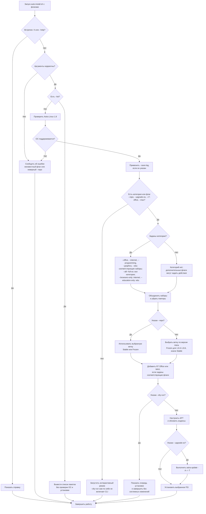

[](/LICENSE)
[](https://astralinux.ru/)
[](https://www.gnu.org/software/bash/)
[](https://github.com/teanrus/astra-gia/blob/main/scripts/auto-install-cli.md)
[](https://github.com/teanrus/astra-gia/blob/main/scripts/auto-install-cli.md)


# CLI-режим `auto-install.sh`

- [Общее описание скрипта](./auto-install.md)
- [Интерактивный режим](./auto-install-interactive.md)

CLI-режим выбирает приложения по категориям без вопроса по каждому приложению. Запускать из каталога, куда пользователь может записывать кэш `.deb`:

```bash
bash auto-install.sh --repo stable --office --internet
```

## Параметры

| Флаг | Действие |
| --- | --- |
| `--repo stable` | Явно выбрать Stable-репозитории Astra Linux 1.8. |
| `--repo frozen` | Выбрать Frozen-репозитории для Astra 1.8.4, 1.8.5 или 1.8.6. На остальных версиях 1.8 завершится ошибкой. |
| `--office` | Выбрать офисный набор. |
| `--internet` | Выбрать браузер, мессенджеры и Сервис Среда. |
| `--programming` | Выбрать инструменты программирования и информатики. |
| `--graphics` | Выбрать графические и мультимедийные приложения. |
| `--edu` | Выбрать учебный набор. |
| `--all` | Объединить все пять категорий. |
| `--full-os` | Алиас `--all`: полный набор приложений скрипта, **не** обновление всей ОС. |
| `--browsers-only` | Алиас `--internet`. |
| `--education-only` | Алиас `--edu`. |
| `--r7-office` | Установить R7 Office из официального репозитория; можно сочетать с категориями. |
| `--r7-office-release` | Установить R7 Office из GitHub Releases напрямую, без обращения к официальному репозиторию; для неинтерактивного резервного запуска. |
| `--max` | Установить MAX из официального репозитория; можно сочетать с категориями. |
| `--upgrade-os` | После обновления индексов APT выполнить рекомендованное Astra обновление `sudo astra-update -A -r -T`, затем продолжить установку выбранного ПО. |
| `--dry-run` | Пропустить системные изменения, обновление индексов и установки; после формирования очереди показать, что было бы установлено. |
| `--list` | Вывести категории/пакеты и завершить работу. Установка не выполняется; `--list` не проверяет ОС. |
| `--save-log` | Записывать вывод в `auto-install-<дата-время>.log` в текущем каталоге. |
| `-h`, `--help` | Вывести справку и завершить работу. |

Параметры категорий можно комбинировать. Неизвестный флаг, отсутствие значения у `--repo` или неподдерживаемое значение (`не frozen/stable`) — ошибка. После разбора корректных аргументов `--list` завершает работу до проверки ОС и системных операций.

## Состав наборов

| Флаг | Приложения, добавляемые в очередь |
| --- | --- |
| `--office` | Foxit PDF Reader, NAPS2, OnlyOffice Desktop Editors, Сервис Среда, R7 Office, MAX |
| `--internet` | ВК Мессенджер, Сервис Среда, MAX, Яндекс Браузер |
| `--programming` | Code::Blocks, Eclipse IDE for C/C++ Developers 2026.09, Eclipse IDE for Java Developers 2026.09, IDLE (пакет `idle`), Notepad++ 8.9.8.1, PascalABC.NET, PyCharm, Visual Studio Code, Python 3.12.13 |
| `--graphics` | Scribus, Audacity, OBS Studio |
| `--edu` | КуМир 2, Basic 256, Code::Blocks, Eclipse IDE for Java Developers 2026.09, IDLE (пакет `idle`), Notepad++ 8.9.8.1, PascalABC.NET, PyCharm, Python 3.12.13, Visual Studio Code, R7 Office, Foxit PDF Reader |
| `--all`, `--full-os` | Объединение всех наборов выше; повторяющиеся приложения добавляются один раз. |
| `--browsers-only` | Тот же состав, что `--internet`. |
| `--education-only` | Тот же состав, что `--edu`. |

R7 Office и MAX также можно выбрать отдельно. Яндекс Браузер, IDLE, Basic 256, Scribus и Audacity устанавливаются через `apt` из выбранных источников Astra. Остальные приложения категорий устанавливаются из `.deb` проекта либо из соответствующих сторонних репозиториев R7/MAX.

Python в категориях всегда выбирается версии 3.12.13. Остальные версии доступны через интерактивный выбор. `--programming` включает Eclipse для C/C++, `--edu` включает Eclipse для Java.

## Автоматический выбор репозитория и подготовка

- Скрипт поддерживает только Astra Linux 1.8. При запуске с категориями и без `--repo` автоматически выбирает Frozen для версий 1.8.4, 1.8.5 и 1.8.6; для остальных выпусков ветки 1.8 выбирает Stable.
- Без флагов выбора приложений скрипт запускается интерактивно. Исключения: `--list` и `--help` сразу завершают выполнение; `--repo`, `--upgrade-os`, `--r7-office`, `--r7-office-release` и `--max` сами включают автоматический режим, даже если категорию не задали.
- `--dry-run` сам по себе не включает автоматический режим. Для пробного CLI-запуска укажите его вместе с категорией, например `--office --dry-run`.
- Обычный запуск настраивает источники, корректирует APT, удаляет точные дубликаты и выполняет `apt-get update`, необходимый для установки выбранных приложений. Сам скрипт не обновляет всю ОС по умолчанию.
- При `--upgrade-os` инсталлятор вызывает `sudo astra-update -A -r -T` после настройки источников и обновления индексов APT, но до установки выбранного ПО. Без этого флага полное обновление ОС не выполняется.
- CLI-режим не предлагает установку SANE и не запускает `autoremove`, `autoclean` или `apt-get clean`.
- Для R7 Office используется репозиторий `deb https://downloads.r7-office.ru/repository/r7-desktop-astra/ astralinux main`; для MAX настраивается официальный репозиторий MAX.
- Если репозиторий R7 Office недоступен, интерактивный запуск предложит установить `r7-office.deb` из GitHub Releases. В автоматическом режиме для прямой установки используйте `--r7-office-release`; резервный пакет и файл `r7-office.deb.sha256` должны быть загружены в релиз `v2.0`.

## Примеры

```bash
# Установить офисный и интернет-наборы, Stable выбрать явно
bash auto-install.sh --repo stable --office --internet

# Все категории приложений; ветка выбирается автоматически
bash auto-install.sh --full-os

# Только учебный набор, без реальных системных изменений
bash auto-install.sh --education-only --dry-run

# Полное обновление ОС рекомендованной утилитой Astra и установка набора
bash auto-install.sh --programming --upgrade-os

# Вывести состав наборов; установки не будет
bash auto-install.sh --list
```

При работе `--dry-run` подготовка репозиториев и установка пропускаются, но без категорий этот флаг не отменяет интерактивные вопросы режима выбора приложений. Если указан `--list`, список печатается и скрипт завершается, независимо от других корректно разобранных параметров.

## Общая логика работы CLI-режима


