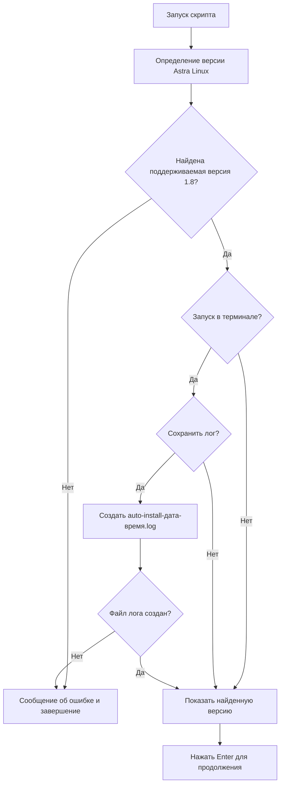
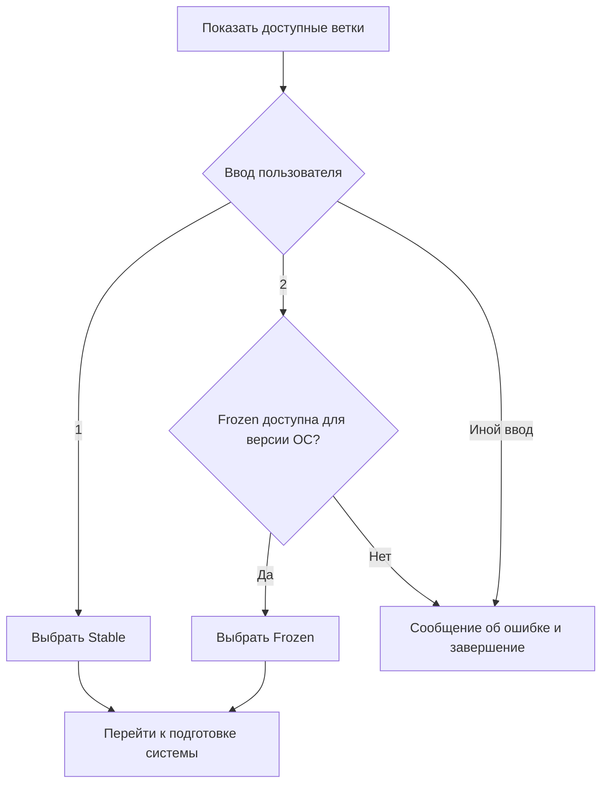
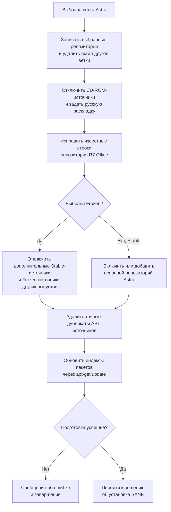
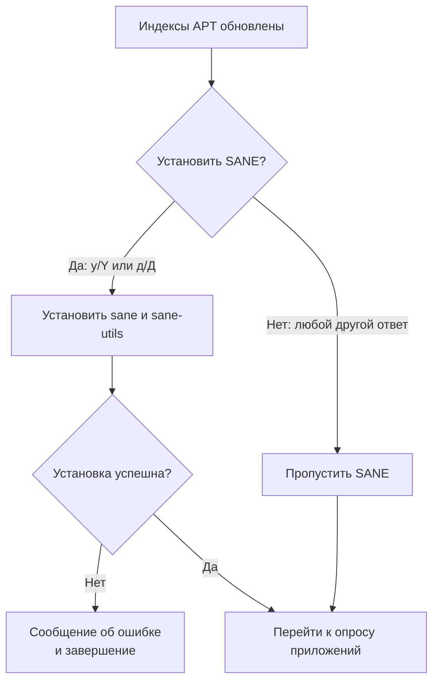
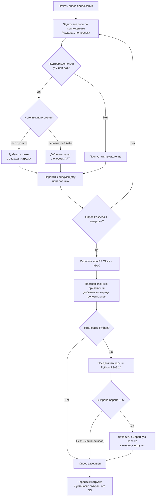
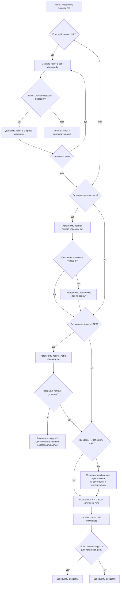

[](/LICENSE)
[](https://astralinux.ru/)
[](https://www.gnu.org/software/bash/)
[](https://github.com/teanrus/astra-gia/blob/main/scripts/auto-install.md)


# Интерактивный режим `auto-install.sh`

- [Общее описание скрипта](./auto-install.md)
- [CLI-режим](./auto-install-cli.md)

Интерактивный режим запускается без флагов, которые переводят скрипт в автоматический режим:

```bash
bash auto-install.sh
```

Это пошаговый опрос по каждому приложению, а не меню категорий. До выбора программ скрипт спрашивает ветку репозитория Astra и выполняет подготовку системы. Поэтому обычный интерактивный запуск — не режим предварительного просмотра.

## Порядок работы

### 1. Проверка ОС и предложение сохранить лог

Сначала скрипт определяет версию Astra Linux из `/etc/astra_version` или `/etc/os-release`. Поддерживается только Astra Linux 1.8. Если запуск происходит в терминале, скрипт предлагает сохранить вывод в лог (`y`/`n`). При подтверждении файл `auto-install-<дата-время>.log` создается в текущем каталоге. Без терминала этот вопрос пропускается.

Затем скрипт показывает найденную версию ОС и просит нажать Enter для продолжения.



### 2. Выбор ветки Astra

- **Stable** — ветка репозитория Astra Linux 1.8.
- **Frozen** — ветка, соответствующая установленной версии; доступна скрипту для 1.8.4, 1.8.5 и 1.8.6.

Ввод `1` выбирает Stable, `2` — доступную Frozen. Для других версий 1.8 предлагается только Stable. Недопустимый ввод или выбор недоступной Frozen завершает работу с ошибкой.



### 3. Подготовка системы

После выбора ветки скрипт выполняет системную подготовку до того, как спросит, какие приложения устанавливать:

1. Записывает выбранные репозитории Astra в `/etc/apt/sources.list.d` и удаляет файл противоположной ветки, созданный этим скриптом.
2. Временно отключает CD-ROM-источники APT и задает русскую раскладку для безынтерактивных установок.
3. Исправляет известные старые строки репозитория R7 Office.
4. Для Frozen отключает дополнительные Stable-источники и Frozen-источники других выпусков. Для Stable включает или добавляет основной репозиторий Astra, нужный для зависимостей.
5. Удаляет точные дубликаты APT-источников и выполняет `apt-get update`.
6. Полное обновление Astra не выполняется. Скрипт обновляет индексы APT только для последующей установки выбранных программ.

Если подготовительные системные команды, от которых зависит дальнейшая работа, завершаются ошибкой, скрипт выводит сообщение и прекращает работу.

> Для полного обновления Astra Linux используйте фирменную утилиту отдельно от инсталлятора: `sudo astra-update -A -r -T`. Интерактивный сценарий `auto-install.sh` не вызывает `astra-update`.



### 4. Решение об установке SANE

После обновления списков пакетов, но до опроса приложений, скрипт предлагает установить подсистему сканирования: `sane` и `sane-utils`.

- Ответ `y`/`Y` или `д`/`Д` устанавливает оба пакета через `apt-get`.
- Любой другой ответ пропускает SANE.



### 5. Выбор приложений

На каждый пункт скрипт задает отдельный вопрос вида «Установить [название]?». Подтверждающий ответ — одна буква `y`, `Y`, `д` или `Д`; любой другой ответ считается отказом. Выбор добавляет приложение в очередь, но установка выполняется после завершения всего опроса.

#### Раздел 1: приложения и пакеты Astra

Вопросы задаются в следующем порядке:

| № | Приложение | Источник |
| --- | --- | --- |
| 1 | Foxit PDF Reader | `.deb` проекта |
| 2 | NAPS2 | `.deb` проекта |
| 3 | OnlyOffice Desktop Editors | `.deb` проекта |
| 4 | ВК Мессенджер | `.deb` проекта |
| 5 | Сервис Среда | `.deb` проекта |
| 6 | Яндекс Браузер (`yandex-browser-stable`) | репозиторий Astra |
| 7 | Scribus | репозиторий Astra |
| 8 | Audacity | репозиторий Astra |
| 9 | OBS Studio | `.deb` проекта |
| 10 | КуМир 2 | `.deb` проекта |
| 11 | Basic 256 (`basic256`) | репозиторий Astra |
| 12 | Code::Blocks | `.deb` проекта |
| 13 | Eclipse IDE for C/C++ Developers 2026.09 | `.deb` проекта |
| 14 | Eclipse IDE for Java Developers 2026.09 | `.deb` проекта |
| 15 | IDLE 3 (Python 3.11, пакет `idle`) | репозиторий Astra |
| 16 | Notepad++ 8.9.8.1 | `.deb` проекта |
| 17 | PascalABC.NET | `.deb` проекта |
| 18 | PyCharm | `.deb` проекта |
| 19 | Visual Studio Code | `.deb` проекта |

#### Раздел 2: приложения из собственных репозиториев

Далее задаются отдельные вопросы:

1. **R7 Office** — при подтверждении добавляется официальный ключ, защищенная конфигурация APT и репозиторий R7 Office для Astra Linux, затем устанавливается пакет `r7-office`.
2. **MAX** — при подтверждении добавляется ключ и официальный репозиторий MAX, затем устанавливается пакет `max`.

#### Раздел 3: версия Python

Сначала задается вопрос, устанавливать ли Python. При подтверждении предлагаются версии:

| Ввод | Версия |
| --- | --- |
| `1` | Python 3.9.25 |
| `2` | Python 3.10.20 |
| `3` | Python 3.12.13 |
| `4` | Python 3.13.15 |
| `5` | Python 3.14.7 |
| `0` | Пропустить |

Выбирается одна версия. Любой другой ввод также пропускает установку Python.



### 6. Загрузка, установка и завершение

- Выбранные `.deb` загружаются в `deb-downloads` в каталоге, из которого запущен скрипт. Каталог сохраняется после установки.
- Пакеты из GitHub Releases проверяются по SHA-256 и формату `.deb`. Пакеты с ошибкой загрузки/проверки пропускаются; скрипт продолжает обработку остальных и в конце возвращает код `1`, если были сбои.
- `.deb` устанавливаются через `apt-get -f -y install`; если общая установка не удалась, скрипт пробует установить каждый пакет отдельно.
- Выбранные пакеты Astra устанавливаются через `apt-get install -y`.
- R7 Office и MAX устанавливаются из своих репозиториев.
- Перед завершением скрипт восстанавливает CD-ROM-записи APT. Неиспользуемые пакеты и кэш APT автоматически не удаляются.



## Варианты запуска, меняющие интерактивный сценарий

- `--save-log` включает логирование без вопроса о сохранении.
- `--dry-run` отдельно не включает автоматический режим. В этом случае остаются вопросы интерактивного режима и выбора репозитория, но системная подготовка и установка пропускаются; SANE не предлагается, а в конце печатается очередь выбранного ПО.
- Флаги категории (`--office`, `--internet`, `--programming`, `--graphics`, `--edu`, `--all`), `--full-os`, `--browsers-only`, `--education-only`, `--repo`, `--upgrade-os`, `--r7-office` и `--max` включают автоматический режим. Вопросы по приложениям не задаются; состав наборов описан в [документе CLI-режима](./auto-install-cli.md).
- `--list` только выводит каталог программ; `--help` показывает справку. Оба завершают работу до интерактивного процесса.

## Пример полного интерактивного запуска

```bash
bash auto-install.sh
```

Обычный запуск проходит все этапы: предложение сохранить лог, подтверждение продолжения, выбор Stable/Frozen, подготовка APT, вопрос об установке SANE, опрос приложений и установку подтвержденных пакетов.

Полное обновление ОС в этот сценарий не входит. Если оно необходимо, выполните `sudo astra-update -A -r -T` отдельно в соответствии с рекомендацией Astra.
